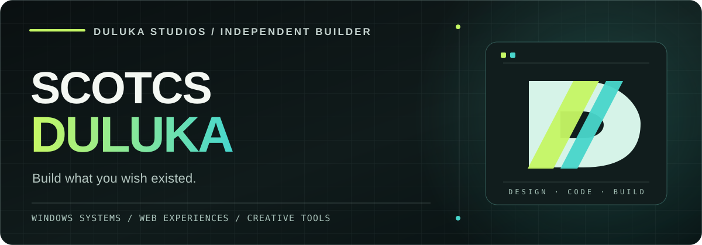

<!-- DULUKA STUDIOS / GITHUB PROFILE — Main branch -->

 

 

**Independent developer · Windows / Web / Mods / Creative Technology**

🇹🇭 Based in Thailand · Thai & English · One person, many experiments.

---

### 01 / HELLO, WORLD

I'm **ScotcsDuluka**, the independent developer behind **Duluka Studios**.

I build software, rebuild interfaces, explore Windows internals, customize Android experiences, and turn curious ideas into working projects. I care about **architecture, UI motion, performance, and the little details people actually feel**.

> **“อยากให้มีอะไรสักอย่าง ก็ลองสร้างมันขึ้นมาเอง”**
>
> *If you wish something existed, try building it yourself.*

My work spans different technologies because I choose the tools to fit the idea — not the other way around.

### 02 / FEATURED WORK

<table>
<tr>
<td width="50%" valign="top">

#### 🎬 [ShadowPlay NEXT](https://github.com/ScotcsDuluka/ShadowPlay-NEXT)

**Windows · Capture · Overlay · Native architecture**

A ground-up rebuild of an independent capture and overlay experience, exploring native hosts, capture engines, CEF-based UI, and cross-process components.

**Stage:** Active architectural rebuild. NEXT CBT1 is not a public release.

[**Explore the engineering repo →**](https://github.com/ScotcsDuluka/ShadowPlay-NEXT)

</td>
<td width="50%" valign="top">

#### ✳️ [Duluka Studios](https://duluka-studios.pages.dev/)

**Portfolio · Next.js · TypeScript · Design**

A home for my projects, experiments, and software work — from desktop systems and web interfaces to mobile mods and media tools.

**Stage:** Studio website / project index.

[**Explore the studio →**](https://duluka-studios.pages.dev/)

</td>
</tr>
<tr>
<td width="50%" valign="top">

#### 🖥️ [Windows 10 Desktop — Web Edition](https://github.com/ScotcsDuluka/Windows-10-Desktop-Web)

**Next.js · TypeScript · Tailwind CSS**

A browser-based desktop experience featuring a taskbar, window manager, Settings, Notepad, and Calculator.

[**Explore the project →**](https://github.com/ScotcsDuluka/Windows-10-Desktop-Web)

</td>
<td width="50%" valign="top">

#### 📱 [Always-On-Display Mods](https://github.com/ScotcsDuluka/Always-On-Display-Mods)

**HyperOS · Magisk · AOD customization**

Experiments in Always-On Display customization with Thai / English language support and visual enhancements.

**Note:** Requires a compatible rooted device. Read the repository warnings before installing.

[**Explore the module →**](https://github.com/ScotcsDuluka/Always-On-Display-Mods)

</td>
</tr>
</table>

<b>More from the workshop</b> — media, games and interface experiments

 

| Project | Exploration |
|:--|:--|
| [Lyrics-TTML](https://github.com/ScotcsDuluka/Lyrics-TTML) | Timed-text lyric files and synchronization |
| [MCDMods-Project-Plus](https://github.com/ScotcsDuluka/MCDMods-Project-Plus) | Minecraft-related project experiments |
| [Web-HyperOS-Launcher](https://github.com/ScotcsDuluka/Web-HyperOS-Launcher) | Web-based launcher / interface work |
| [Web-Custom](https://github.com/ScotcsDuluka/Web-Custom) | Additional web experiments |

These are projects of different sizes and maturity levels; a repository's existence does not mean a release is ready.

### 03 / TOOLS OF THE TRADE

**Languages**

**Frameworks & platforms**

**Engineering & workflow**

### 04 / HOW I BUILD

| Principle | What it means in practice |
|:--|:--|
| **Dream up** | Start with the experience I wish existed. |
| **Prototype fast** | Test an idea with real code before polishing the story. |
| **Design with intent** | Animation, layout, and interaction should serve the user. |
| **Engineer for change** | Make room for refactoring, better architecture, and better tools. |
| **Keep adapting** | Learn from failures, iterate, and ship improvements. |

### 05 / CURRENT FOCUS

- **ShadowPlay NEXT:** Capture pipeline, native integration, overlay architecture and build tooling.
- **Duluka Studios:** A clear home for projects, development notes, and experiments.
- **Creative experiments:** Web interfaces, HyperOS customization, Minecraft tooling, and timed-text lyrics.

Some work is experimental or in progress. Please check each repository's README, release page, and license before using or distributing code. ShadowPlay NEXT is an unofficial independent project and is not affiliated with NVIDIA.

### 06 / GITHUB PULSE

### 07 / FIND ME

**A good idea is worth exploring.**

[**Studio website**](https://duluka-studios.pages.dev/) &nbsp;·&nbsp;
[**GitHub projects**](https://github.com/ScotcsDuluka?tab=repositories) &nbsp;·&nbsp;
[**Discord community**](https://discord.gg/v5qUGVD3jZ)

 

**DULUKA STUDIOS™**  
Independent by design. Curious by default.

<!-- End of profile -->