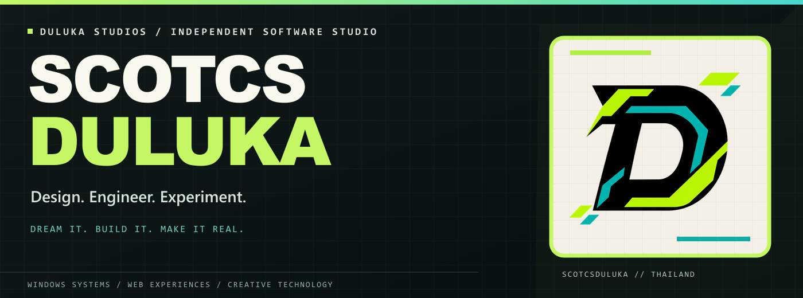
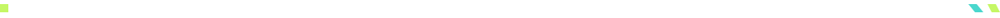
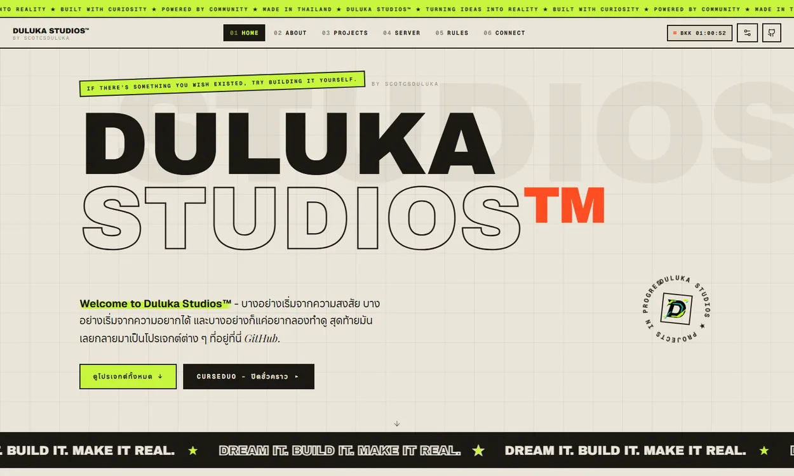

<!--
  DULUKA STUDIOS™ / STUDIO EDITION
  github.com/ScotcsDuluka
  Visual identity: charcoal #0B1212 | lime #C5F765 | turquoise #49D7CD
  Studio hero uses the ORIGINAL Logo_Ap.png supplied by the author.
  All showcased project links below have been checked against public repositories.
-->

  

  

**DESIGN. ENGINEER. EXPERIMENT.**

*Independent developer · Windows systems · Web experiences · Creative technology*

**DREAM IT. BUILD IT. MAKE IT REAL.**

## 01 — THE STUDIO

Hey, I'm **ScotcsDuluka**, the independent developer behind **Duluka Studios™**, based in Thailand.

I build the software and interfaces I wish existed: a screen-capture platform, desktop experiences on the web, Android customization, and small tools that begin as curiosities. I care about the parts people can *see* — and the architecture that makes them work.

> **“อยากให้มีอะไรสักอย่าง ก็ลองสร้างมันขึ้นมาเอง”**
>
> *If you wish something existed, try building it yourself.*

**My approach:** dream up an idea → build a prototype → test the reality → improve the details → keep adapting.

<strong>🇹🇭 เกี่ยวกับ Duluka Studios (ภาษาไทย)</strong>

 

Duluka Studios™ คือพื้นที่รวมผลงานและการทดลองด้านซอฟต์แวร์ของ ScotcsDuluka ตั้งแต่โปรแกรมบน Windows งานออกแบบเว็บ การปรับแต่ง Android/HyperOS ไปจนถึงเครื่องมือและโปรเจกต์ที่เกิดจากความอยากรู้อยากลอง

**แนวคิดหลัก:** ถ้าอยากให้มีสิ่งนั้นอยู่ ก็ลองลงมือสร้างมันขึ้นมาเอง

## 02 — SELECTED WORK

*Real projects. Real repositories. Different stages of development.*

### 01 / [DULUKA STUDIOS™](https://duluka-studios.pages.dev/)

▲ Actual public homepage captured from the live site in November 2026 — not a mockup.

**A home for ideas that refuse to stay ideas.**

A project portfolio and experiment hub built with **Next.js, TypeScript and React**. The site brings together desktop systems, interfaces, mods, and the work in progress behind them.

**[OPEN THE STUDIO ↗](https://duluka-studios.pages.dev/)**

---

### 02 / [SHADOWPLAY NEXT](https://github.com/ScotcsDuluka/ShadowPlay-NEXT)

**A Windows capture and overlay platform being rebuilt from the inside out.**

An independent engineering project exploring a native host, recording pipeline, overlay architecture, CEF-based UI components, and cross-process integration.

**Current reality:** NEXT CBT1 is under development, **not a public release**. The older OBT3 generation is distinct from NEXT. This is an unofficial independent project, not affiliated with NVIDIA.

<strong>VIEW A VERIFIED PROJECT IMAGE</strong> · legacy overlay screenshot from the repository

 

Archive image stored in the public repository. It illustrates a legacy interface, not a completed NEXT CBT1 build.

**[EXPLORE THE REBUILD ↗](https://github.com/ScotcsDuluka/ShadowPlay-NEXT)** · [Development history](https://github.com/ScotcsDuluka/ShadowPlay-NEXT/commits/Stable)

---

### 03 / [WINDOWS 10 DESKTOP — WEB EDITION](https://github.com/ScotcsDuluka/Windows-10-Desktop-Web)

**A desktop-style interface that runs inside the browser.**

A Next.js / TypeScript experiment with a **taskbar, draggable app windows, Settings, Notepad, and Calculator**. Built to explore desktop interaction patterns in a web environment.

**[EXPLORE THE PROJECT ↗](https://github.com/ScotcsDuluka/Windows-10-Desktop-Web)**

---

### 04 / [ALWAYS-ON-DISPLAY MODS](https://github.com/ScotcsDuluka/Always-On-Display-Mods)

**Making the small details on Android feel personal.**

Experimental HyperOS Always-On Display customization with language and visual modifications. Requires a **compatible rooted device with Magisk**; back up the original AOD package and read the device warnings before installing.

**[EXPLORE THE MODULE ↗](https://github.com/ScotcsDuluka/Always-On-Display-Mods)**

<strong>+ THE REST OF THE WORKSHOP</strong> · music, mods, launchers, interfaces

 

- **[Lyrics-TTML](https://github.com/ScotcsDuluka/Lyrics-TTML)** — timed lyrics and synchronization experiments.
- **[MCDMods-Project-Plus](https://github.com/ScotcsDuluka/MCDMods-Project-Plus)** — Minecraft-related development.
- **[Web-HyperOS-Launcher](https://github.com/ScotcsDuluka/Web-HyperOS-Launcher)** — launcher and mobile-interface exploration.
- **[Web-Custom](https://github.com/ScotcsDuluka/Web-Custom)** — custom web experiments.

*All links above lead to public repositories. Availability and project maturity vary; see each repository for up-to-date requirements and releases.*

## 03 — TOOLS OF THE TRADE

**LANGUAGES**

**FRAMEWORKS & INTERFACES**

**PLATFORMS & WORKFLOW**

These tools span multiple experiments. Not every project uses every tool.

## 04 — HOW I BUILD

1. **DREAM UP** — imagine something worth making.
2. **BUILD TO LEARN** — prototype the core, then test.
3. **DESIGN WITH INTENT** — refine layout, motion, and usability.
4. **ENGINEER FOR CHANGE** — document decisions and improve architecture.
5. **KEEP ADAPTING** — learn from what breaks, then rebuild it better.

### On the workbench

- **ShadowPlay NEXT** — capture, overlay, native integration and build tooling.
- **Duluka Studios** — the portfolio, visual identity, and project discovery experience.
- **Side experiments** — web desktop interfaces, HyperOS mods, Minecraft tooling, and timed lyrics.

## 05 — THE STUDIO PULSE

<strong>VIEW ADDITIONAL GITHUB STATS</strong> · provided by third-party widgets

 

Third-party images may be temporarily unavailable. Language distribution is not a measure of proficiency.

## 06 — LET'S CONNECT

**IF IT DOESN'T EXIST, BUILD IT.**

[**Studio website**](https://duluka-studios.pages.dev/) &nbsp;·&nbsp; [**GitHub projects**](https://github.com/ScotcsDuluka?tab=repositories) &nbsp;·&nbsp; [**Discord community**](https://discord.gg/v5qUGVD3jZ)

 

**DULUKA STUDIOS™**

INDEPENDENT BY DESIGN · CURIOUS BY DEFAULT · MADE IN THAILAND 🇹🇭

<!-- END / STUDIO EDITION / DREAM IT. BUILD IT. MAKE IT REAL. -->
